<!-- hero: 3D ascii wordmark, extruded "YAHYA" that wipes in, then rocks on its
     vertical axis. regenerate with: python scripts/make_wordmark_svg.py -->

  

<!-- section headers are terminal prompts that type themselves out.
     regenerate with: python scripts/make_prompt_svg.py -->

<!-- left: ascii portrait that types itself in row by row
       (python scripts/prep_photo.py data/source-photo.jpeg && python scripts/make_ascii_svg.py)
     right: neofetch-style card; its live stats are re-rendered daily
       (python scripts/make_info_card.py) -->

<table>
  <tr>
    <td valign="top"></td>
    <td valign="top"></td>
  </tr>
</table>

 

  

<!-- animated contribution graph: real data, boxes pop in cell by cell
     (regenerated daily by .github/workflows/update-profile-art.yml) -->

 

<!-- monthly bar chart + activity ring, same data source as the heatmap.
     regenerate with: python scripts/render_contrib_stats_svg.py -->

  

 

<!-- rewritten daily by scripts/update_readme_repos.py; edits inside the markers are overwritten -->
<!-- repos:start -->
<table>
  <thead><tr><th>repo</th><th>about</th><th>lang</th><th>pushed</th></tr></thead>
  <tbody>
    <tr><td><a href="https://github.com/Yahya3mn/PBCNet-SE-MBConv"><b>PBCNet-SE-MBConv</b></a></td><td>&nbsp;</td><td><code>Jupyter Notebook</code></td><td>Jun 2026</td></tr>
    <tr><td><a href="https://github.com/Yahya3mn/Anomaly_Detection_Application"><b>Anomaly_Detection_Application</b></a></td><td>Data_Analaysis</td><td><code>Jupyter Notebook</code></td><td>Mar 2026</td></tr>
    <tr><td><a href="https://github.com/Yahya3mn/Derin_Ogrenme_Ile_Etnik_Koken_Yas_ve_Cinsiyet_Tahmini"><b>Derin_Ogrenme_Ile_Etnik_Koken_Yas_ve_Cinsiyet_Tahmini</b></a></td><td>Python, ImageProcessing</td><td><code>Jupyter Notebook</code></td><td>Dec 2024</td></tr>
    <tr><td><a href="https://github.com/Yahya3mn/Okul_Yonetim_Sistemi"><b>Okul_Yonetim_Sistemi</b></a></td><td>PHP/LARAVEL</td><td><code>JavaScript</code></td><td>Sep 2024</td></tr>
    <tr><td><a href="https://github.com/Yahya3mn/Kotlin_BesinKitabiUygulamasi"><b>Kotlin_BesinKitabiUygulamasi</b></a></td><td>Kotlin_Java</td><td><code>Kotlin</code></td><td>Jul 2024</td></tr>
  </tbody>
</table>
<!-- repos:end -->

 

  

  

  

 

